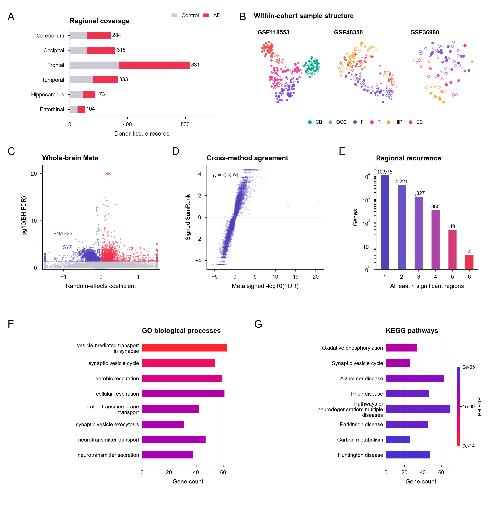
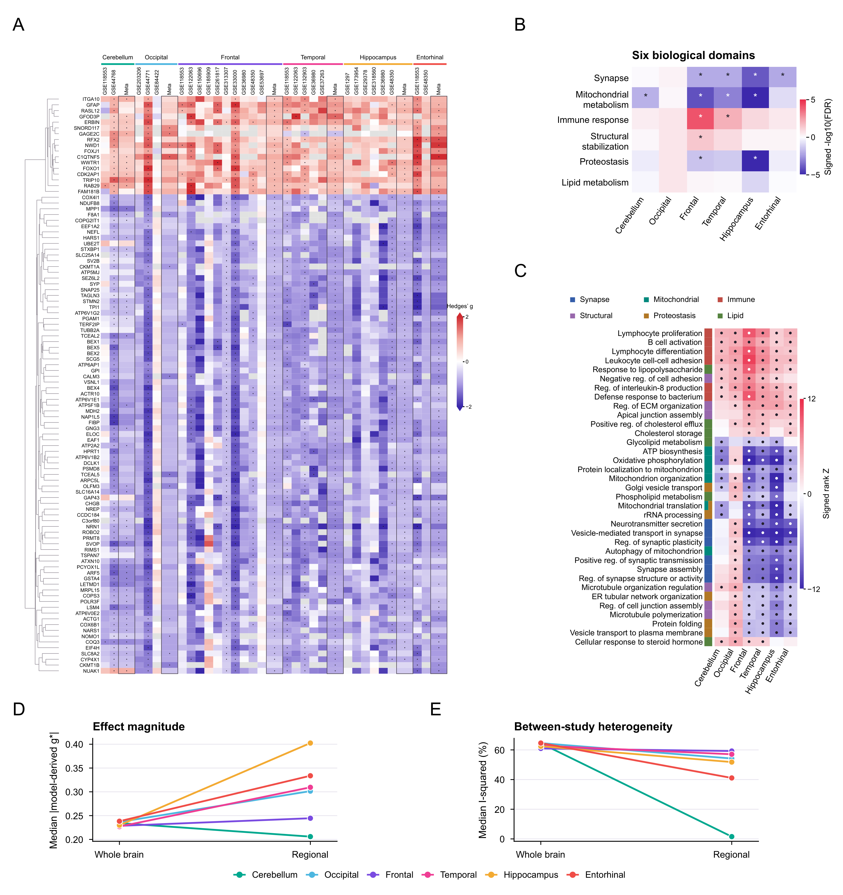
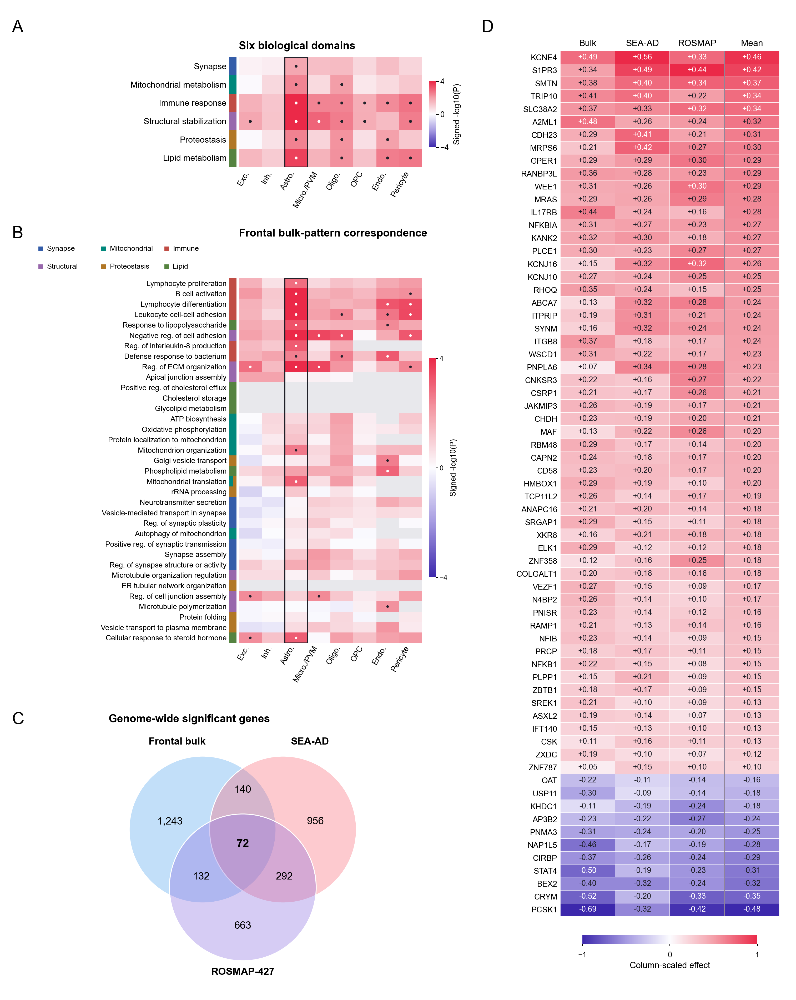
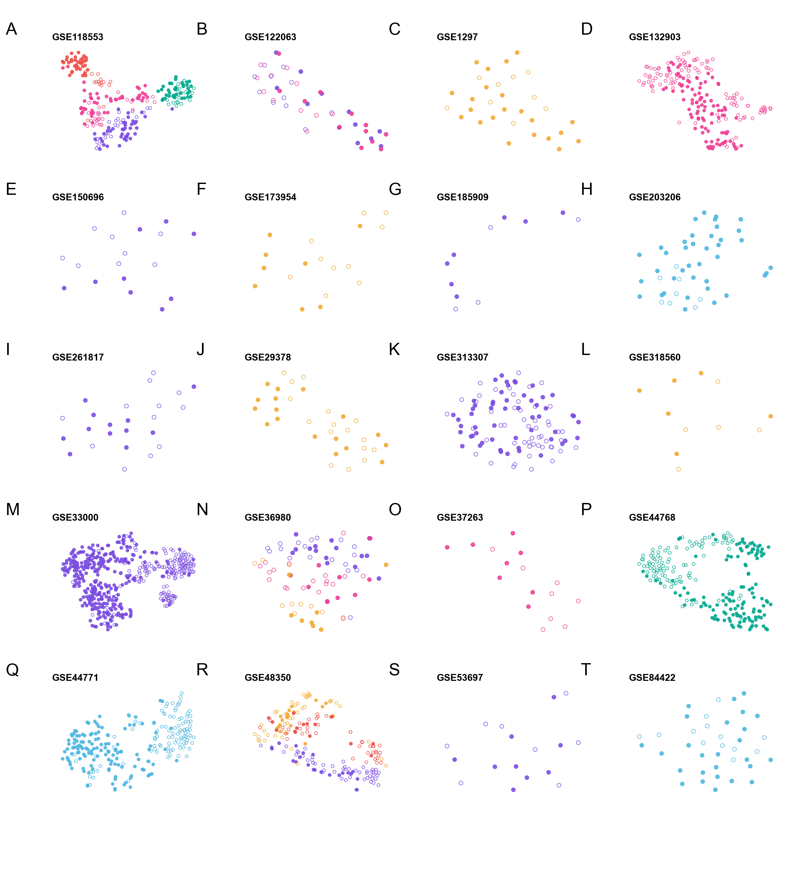
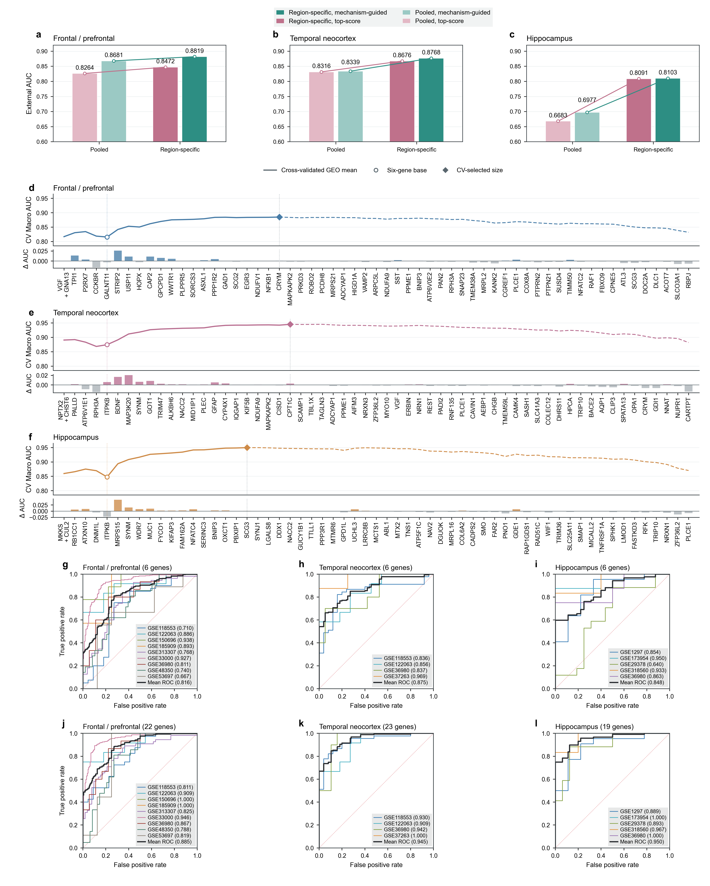
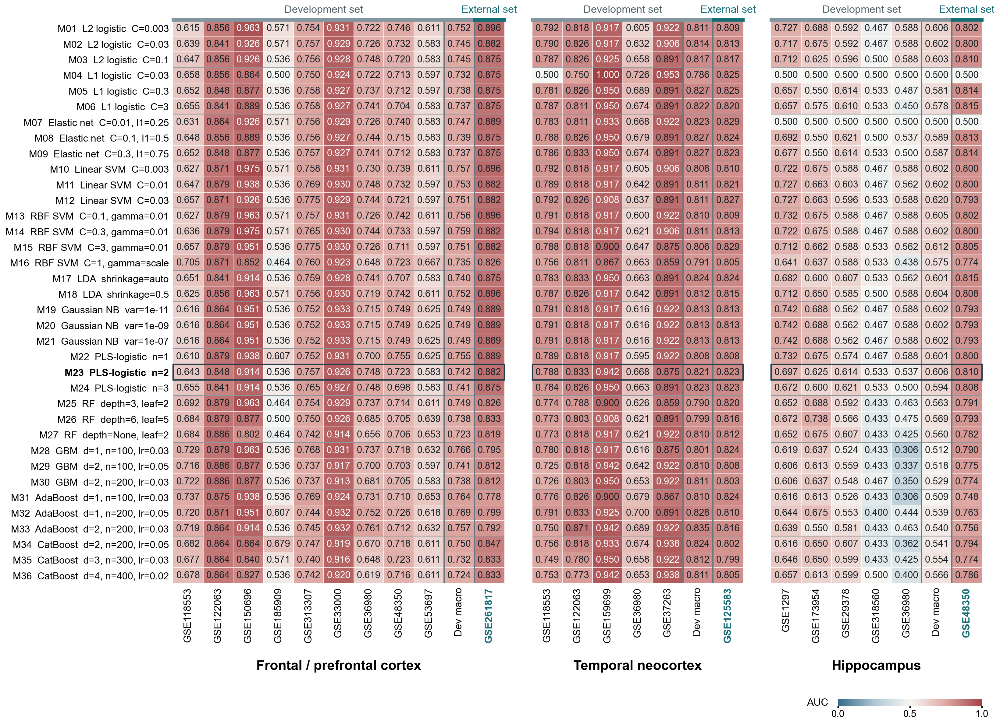

# AD Region

阿尔茨海默病跨脑区转录组 Meta 分析与区域基因 Panel 的核心图、绘图源数据和汇总结果。归档日期：2026-11-16。

本仓库是当前初稿的**公开结果归档**，不是完整原始数据镜像，也不是可直接移机运行的分析软件包。图件直接保留已有 PNG、PDF、SVG，没有重新拟合模型、重算统计量或修改图中结果。

## 快速入口

- [完整文件索引](FILE_INDEX.md)
- [归档范围与处理记录](PUBLICATION_SCOPE.md)
- [逐文件大小与 SHA256](DATA_MANIFEST.csv)
- [第一部分：逐子图数据对应](第一部分meta/逐子图数据索引.md)
- [第一部分：四页组图 PDF](第一部分meta/全部组图合订预览_四页_六机制八类细胞.pdf)
- [论文表格：队列与 67 基因功能](第一部分meta/07_论文表格/论文表格_队列与67基因功能.pdf)

## 第一部分：Meta 与机制分析

包含 3 幅主图、1 幅补充图及独立子图。研究覆盖 20 个 GEO 系列、28 个队列与脑区贡献，共 2,041 条供体与组织记录（1,151 AD、890 对照）；记录数不等于跨脑区去重后的独立供体人数。

| 图 | 内容 | 对应结果 |
| --- | --- | --- |
| 图 1 | 整脑与跨脑区共同转录异常 | [数据与结果](第一部分meta/01_图1_整脑与跨脑区共同异常/数据与结果) |
| 图 2 | 脑区分层、经典效应量与六机制 | [数据与结果](第一部分meta/02_图2_脑区分层与六机制/数据与结果) |
| 图 3 | 额叶星形胶质细胞的跨来源呼应 | [数据与结果](第一部分meta/03_图3_额叶星形胶质细胞/数据与结果) |
| 补充图 1 | 20 个 GEO 的样本级 t-SNE | [坐标、参数与特征名单](第一部分meta/04_补充图1_二十队列样本级tSNE/数据与结果) |

图 2A 使用经典 Hedges' g，图 2D 使用差异模型衍生的 g*，不能混用。图 3 的单核来源是连续病理指标关联，不是 AD/对照二分类效应；67 个三来源同向基因的原始系数均值仅作描述性汇总。

### 图 1



### 图 2



### 图 3



### 补充图 1



## 第二部分：区域 Panel

两张定稿图来自**不同实验版本**，不能把其中的开发分数或颞叶外部结果当作同一个量比较。

| 项目 | 图 01：四策略与扩展 ROC | 图 02：36 配置热图 |
| --- | --- | --- |
| 版本 | 11 月 15 日冻结四策略；11 月 16 日 CV 扩展 | 11 月 13 日模型比较 |
| 额叶、颞叶、海马外部 GEO | GSE261817 / **GSE132903** / GSE48350 | GSE261817 / **GSE125583** / GSE48350 |
| 开发评价 | 固定六基因底座；逐 GEO 等权 | 每折重选六基因；来源家族等权 |
| 直接作图数据 | [曲线、ROC 坐标与 AUC](第二部分panel/02_主图_M23冻结Panel/作图/源数据) | [热图矩阵](第二部分panel/03_模型热图_1113独立版本/热图矩阵) |
| 详细结果 | [四策略与 CV 扩展](第二部分panel/02_主图_M23冻结Panel) | [模型排名与 AUC](第二部分panel/03_模型热图_1113独立版本/结果) |

图 01 的扩展规模为额叶 22、颞叶 23、海马 19 个基因，对应开发 CV Macro AUC 为 0.885058、0.945243、0.949788。CV 分数参与贪婪搜索及规模选择，不能解释为完全独立、未参与选择的最终性能估计。既有外部划分也曾用于前期探索，不宣称对整个开发历史全局盲测。

### 图 01：四策略、贪婪扩展与 ROC



### 图 02：36 配置热图



## 数据与复现边界

公开内容包含基因级统计量、机制检验、候选及 Panel 名单、队列级 AUC、ROC 坐标、热图矩阵和论文表格。供体明细、样本映射、逐样本预测、表达输入、拟合模型及训练缓存未上传。t-SNE 表只移除样本键 `key`，其坐标、分组和 GEO/脑区标记保持不变。

保留的 Python/R 脚本用于方法溯源，部分仍依赖未收入的项目目录和输入。其存在不表示整条分析已经在本仓库中独立复现。可用 Python 标准库核对归档文件的完整性：

```console
python tools/verify_archive.py
```

上游数据出处见队列表、平台来源及原图注。第三方数据的使用条件以原始来源为准；本次归档没有替第三方数据另行指定开放许可，也没有自动给原创代码或图件添加许可证。
